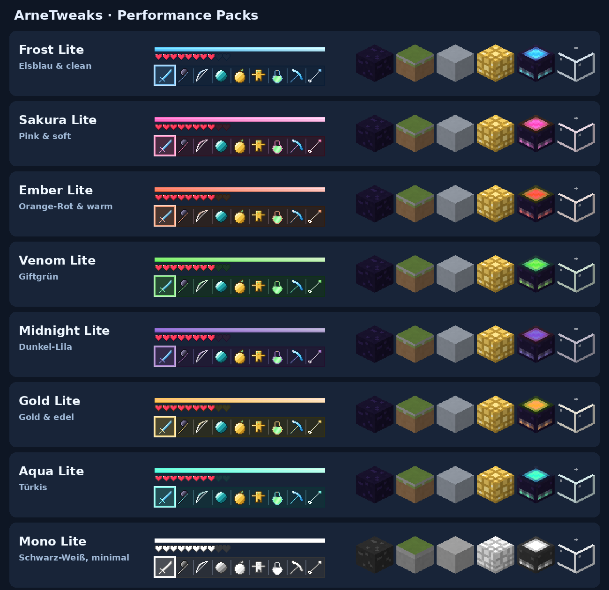
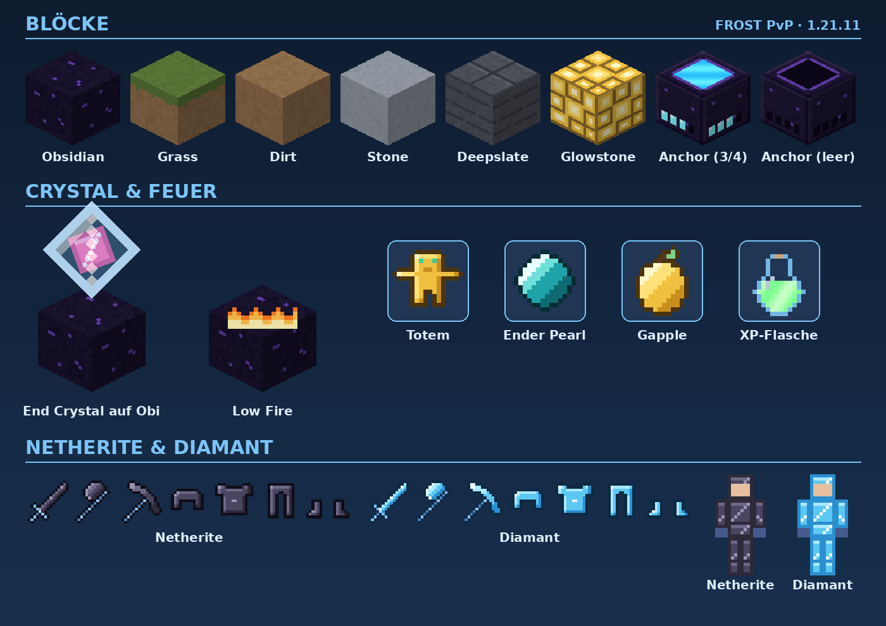

# Texture Packs (Minecraft 1.21.11)

Alle Packs sind selbst erstellt (keine Vanilla- oder Fremd-Texturen) und liegen als fertige ZIPs hier.
Installieren: ZIP in `%appdata%\.minecraft\resourcepacks\` legen (nicht entpacken), im Spiel unter
Optionen → Ressourcenpakete aktivieren.

## Performance (für schwache PCs)



| Pack | Stil |
|---|---|
| `ArneTweaks_FrostLite.zip` | Eisblau & clean |
| `ArneTweaks_SakuraLite.zip` | Pink & soft |
| `ArneTweaks_EmberLite.zip` | Orange-Rot & warm |
| `ArneTweaks_VenomLite.zip` | Giftgrün |
| `ArneTweaks_MidnightLite.zip` | Dunkel-Lila |
| `ArneTweaks_GoldLite.zip` | Gold & edel |
| `ArneTweaks_AquaLite.zip` | Türkis |
| `ArneTweaks_MonoLite.zip` | Schwarz-Weiß, minimal |
| `ArneTweaks_CrimsonLite.zip` | Blutrot & aggressiv |
| `ArneTweaks_OceanLite.zip` | Tiefblau |
| `ArneTweaks_LimeLite.zip` | Neon-Limette |
| `ArneTweaks_LavenderLite.zip` | Pastell-Lila |
| `ArneTweaks_MintLite.zip` | Pastell-Mint |
| `ArneTweaks_NoirLite.zip` | Dunkel & schlicht |
| `ArneTweaks_CyberLite.zip` | Neon-Pink |
| `ArneTweaks_CopperLite.zip` | Kupfer & warm |

Alle Lite-Packs sind auch direkt in ArneTweaks eingebaut (Menü → Reiter **Performance**).

Was sie leicht macht:
- Blöcke in 8x8 statt 16x16 (ein Viertel des Grafikspeichers)
- keine Animationen (Wasser, Lava, Feuer, Nether-Portal, Seelaterne, Magma, Seetang, Stämme, ...)
- Low Fire, keine Sounds, ca. 115 KB pro Pack
- Diamant bleibt blau, Netherite dunkel, Gold gelb: Stufen sind in jedem Theme erkennbar

Ein Texture Pack allein bringt nur wenige FPS. Für spürbar mehr FPS zusätzlich Sodium nutzen
und die Render-Distanz senken.

## PvP: Frost PvP



Clean, eisblau, mit eigenen Sounds (Treffer, Crit, Bogen-„Ding“, Perle, XP, Essen, Schild, Glas, ...).
Enthält u. a. alle Werkzeuge und Rüstungen, End-Kristall, Respawn Anchor mit gut sichtbarer Ladung,
Glowstone, Deepslate, Low Fire, Totem, Gapple, XP-Flasche und eine eigene HUD.

## Neu erzeugen

Die Packs werden komplett per Python (Pillow, NumPy) und ffmpeg (libvorbis) erzeugt:

```
python tools/texturepacks/textures.py
python tools/texturepacks/extras.py
python tools/texturepacks/sounds.py
python tools/texturepacks/lite.py
```

Die Ausgabe landet in `build/texturepacks/` (FrostPvP als Ordner, Performance-Packs als ZIPs).
